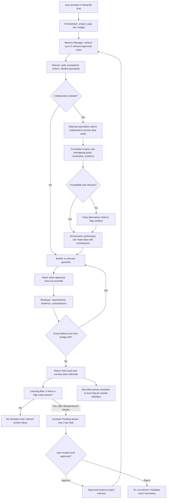

# ANTIGRAVITY V2 MASTER BUILD SPEC — GEMINI FREE-TIER + OBSIDIAN SMART MEMORY + TEAM AI

**Purpose:** This is a COMPLETE, STANDALONE implementation handoff for Google Antigravity (the coding IDE/agent). The user can paste this file into a new Antigravity workspace/chat and ask Antigravity to **build and run** the application, not merely describe a plan.

**Project name:** Gemini Obsidian Learning Agents  
**Target platform:** Windows 10/11, local-first desktop use  
**Runtime AI provider:** Gemini Developer API, eligible **free-tier** model (default `gemini-3.5-flash-lite`, verify availability in the user's AI Studio project)  
**Programming language:** Python 3.11+  
**User interface:** local Streamlit browser dashboard, initially `http://localhost:8501`  
**Long-term memory:** Obsidian vault with only high-value, concise, deduplicated, user-approved Markdown knowledge; run details kept outside the vault  
**Orchestration:** Python with explicit, testable agent roles and deterministic safety gates  
**Learning approach:** persistent experience + reflection + human-verified memory + evaluations, **NOT** autonomous model weight training  
**Estimated hardware:** ordinary modern PC with 8 GB RAM minimum practical; 16 GB preferred; no dedicated GPU is needed for cloud Gemini.  
**Document version:** 2.0 (October 29, 2026); standalone and supersedes the earlier master specification

**V2 precedence rule:** If the older master file exists, this V2 file wins when instructions differ. In particular: no routine transcripts in Obsidian; collaboration is selective and task-local. Preserve existing data and require approval before old-note cleanup.

---

## 0. FIRST INSTRUCTIONS FOR ANTIGRAVITY — READ THESE BEFORE EDITING ANYTHING

You are the implementation engineer for this project. Treat THIS document as the governing technical specification and task checklist. Do not stop at architecture diagrams or code examples. **Create the actual files, run relevant local tests, document the exact commands, and report what is verified versus what still requires the user's Gemini API key or approval.**

1. Inspect the current workspace first. If a working `agents.py`, `Obsidian-Brain/`, and `README.md` already exist, **preserve existing capabilities**, make a backup or Git commit, and incrementally migrate the starter. If the workspace is empty, build the project from scratch per this spec. Do not assume source files are present just because they are mentioned in this handoff.
2. Never delete an existing user's Obsidian notes, pending lessons, approved lessons, run history, or `.env`. Never overwrite user data without explicit approval. Do not print or commit API secrets.
3. Treat runtime Gemini API usage as **separate from Antigravity's own coding-agent access**. The finished application must run independently through the user's Gemini Developer API key and **must not require Antigravity to remain open**.
4. Use **the free tier only by default**: no automatic billing enablement, no paid-only endpoints, no third-party subscriptions. Check model availability and active quotas; if the default model is unavailable, explain how to select another free-tier model rather than silently switching to a paid model.
5. The application must be usable by someone who does not want to type lengthy terminal commands: provide a browser-based Chat UI and a clearly documented Windows startup process. Keep the existing CLI functional when migrating it.
6. Implement **seven logical specialist agents plus one orchestrator**. A logical agent may be an LLM prompt role or a deterministic Python function. Do not spawn seven permanent processes or make seven API calls for trivial tasks.
7. After every task **evaluate whether any valuable lesson exists**, but DO NOT automatically create a memory note. Save to Obsidian only durable, novel, reusable, relevant knowledge; skip routine tasks and low-value results. Put compact technical activity history outside the vault with retention controls. This improves retrieval quality and keeps the vault small. It does NOT retrain Gemini weights.
8. Keep qualifying candidate lessons in **Pending** until the user explicitly approves them; allow correction, rejection, versioning, conflict detection, rollback, and scope limitations. Do NOT store raw responses, agent chatter, full transcripts, temporary ideas, or every run in Obsidian. Use a compact, bounded SQLite activity record outside the vault if needed for troubleshooting.
9. Never trust LLM-generated claims of test success: only actual executed tests with captured exit status/logs count as verified. Do not execute arbitrary shell commands generated by agents without separate explicit user approval and an allowlist/sandbox strategy.
10. At each major milestone, update `BUILD_PROGRESS.md` with completed work, failing tests, blockers, and the next precise step. Finish with a reproducible runbook and a demo prompt.
11. If access to the Gemini API isn't available in this environment, implement mock providers/tests and mark live integration **UNVERIFIED**, then give the user one short action to configure `.env` locally. Never fake an end-to-end API test.
12. Where this specification gives a sensible default, implement it and proceed. Ask the user only when a security-sensitive action, expenditure, destructive change, or truly blocking choice requires explicit approval.

**Suggested first user prompt in Antigravity (V2):**

> Read `ANTIGRAVITY_V2_SMART_MEMORY_AND_TEAM_COLLABORATION.md` completely. Treat V2 as the governing specification over the older master document. Inspect my workspace and preserve existing functionality. Build the seven-agent Gemini free-tier + Obsidian system with Streamlit chat, collaborative team ideas, and selective high-value memory. Do not put full task logs or routine conversations into Obsidian. Implement incrementally, test each phase, update BUILD_PROGRESS.md, and show me how to launch and prompt the agents. Do not stop at a plan.

### Persistent Antigravity instructions

After reading this handoff, create a short workspace-root `AGENTS.md` (or `GEMINI.md`) with the stable constraints above and a link to this master file. Antigravity's documentation states that workspace `AGENTS.md`/`GEMINI.md` are automatically discovered. Keep concise rules there; do not force the entire large specification into every prompt. If this document is updated, check for conflicting rules.

Official Antigravity rules documentation: https://antigravity.google/docs/rules/  
Official Antigravity IDE documentation: https://www.antigravity.google/docs/ide/overview/

---

## 1. WHAT THE USER WANTS

Build a personal, flexible, low-cost AI assistant system which:

- Accepts normal conversational prompts such as **“Help me build a Laravel website”** through a local web dashboard.
- Uses **Gemini free-tier API** for model reasoning, while **Python manages agent orchestration**.
- Has **seven agents with separate tasks**, called selectively when useful.
- Uses **Obsidian as a compact, readable, editable second brain** that stores only selected important lessons and decisions, not a transcript archive.
- Lets relevant specialists contribute independent ideas, detect relationships, challenge contradictions, and produce a shared **Team Idea** backed by evidence; unrelated ideas remain separate.
- **Understands context across tasks** by retrieving project notes, approved rules, and relevant experiences.
- **Improves while performing work** via verification, corrective revision, and feedback loops.
- **Improves over many tasks** by remembering corrections, detecting repeating mistakes, maintaining lessons, measuring performance, and promoting only human-approved knowledge.
- Shows what each agent is doing and which memory items were used.
- Works on ordinary Windows hardware without a powerful GPU or paid cloud infrastructure.
- Continues to work when Antigravity is closed; the user runs the app locally.
- Can eventually add optional web research, filesystem actions, GitHub support, and scheduling, but only with deliberate permissions.

**Not in scope for the first release:** self-retraining Gemini weights, unrestricted autonomous internet browsing or code execution, automatic purchasing, automatic cloud deployment, unapproved modification of unrelated files, guaranteed 24/7 operation, or promises of unlimited free API usage.

---

## 2. FULL OPERATING FLOW — SMART MEMORY + COLLABORATIVE TEAM REASONING

The Orchestrator should **route based on complexity**. Do not invoke every agent on trivial questions. Individual agent contributions are brief structured results, not entire internal reasoning transcripts. All roles share one Gemini API key but use different scoped instructions.



### A normal team example

**User:** “Design a safe Laravel reservation checkout flow.”

1. **Memory Manager:** finds 2-3 approved notes about this specific project, not every past task.
2. **Planner:** defines a reservation lifecycle, testable criteria, and requests Researcher + Developer + Tester (only if warranted).
3. **Researcher:** offers a concise idea: verify payment state through a trusted callback and identify unknowns; label unverified API claims.
4. **Developer:** independently offers a transaction/state-machine approach that prevents duplicate reservations.
5. **Correlation engine:** detects that the payment and reservation ideas share the same state transition, connects them, and flags assumptions.
6. **Team Synthesis:** combines compatible proposals: “Verify payment event, then atomically activate only one reservation; make repeats idempotent.” The team idea records which parts came from which specialist.
7. **Tester:** proposes/runs allowed replay and duplicate-callback checks; no claim of a pass unless a test actually ran.
8. **Reviewer:** challenges missing cases and requests a bounded revision if needed.
9. **Result:** show a single, coherent team recommendation plus open disagreements—not a pile of agent monologues.
10. **Learner/Memory Manager:** normally store **nothing** unless a reusable verified fix, durable project decision, or explicit user preference emerged. If worthy, create one short **Pending** lesson; do not save the whole discussion.

**Core requirement:** team collaboration happens in temporary task context; only valuable, reviewed outcomes become long-term memory.

---

## 3. ALL AGENTS AND THEIR RESPONSIBILITIES

| Component | Inputs | Responsibilities | Outputs | Invocation policy |
|---|---|---|---|---|
| **Orchestrator (control plane)** | User prompt, session, project, settings | Task classification, select agents, budgets, retries, statuses, cancellation, error handling | Run state, final response, run ID | Every task; deterministic Python first |
| **1. Memory Manager** | Query, project ID, vault, memory metadata | Retrieve relevant approved notes, detect memory conflicts, write pending lessons, manage approvals, avoid secret ingestion | Ranked memories, linked citations, memory changes | Every task; mostly deterministic |
| **2. Planner** | Prompt, relevant context | Clarify goals, break into actionable steps, define acceptance checks, choose required agents | Structured plan and success criteria | Complex tasks; skip for simple chat |
| **3. Researcher** | Missing questions, docs, approved tools | Search vault and optionally approved official websites; cite sources and dates; distinguish facts from assumptions | Research report with provenance | Only if research is necessary and enabled |
| **4. Developer / Builder** | Plan, context, research | Produce code or task content; optionally propose workspace patches | Draft answer or proposed changes | When creation or problem-solving is needed |
| **5. Tester / QA** | Output, expected behavior | Run approved deterministic tests; analyze logs; check factual and formatting constraints; report failures | Test report with pass/fail evidence | When feasible, no fabricated tests |
| **6. Reviewer / Critic** | Goal, draft, tests | Find missing requirements, inconsistency, risk; request targeted revision | Review decision and issues | Complex/high-impact tasks |
| **7. Learning / Reflection** | Run log, feedback, actual tests | Determine what worked/failed, extract candidate reusable lessons, recommend prompt/process changes | Candidate lesson(s), improvement proposal, evaluation labels | After every finished task, but avoid unnecessary model calls |

### Agent interaction rules

- Each role has a dedicated Markdown instruction file in Obsidian under `02_Agents/`.
- Use **one Gemini client and configurable model**, not separate keys/accounts for every agent.
- An agent's task prompt must include only the minimal relevant trusted memory and necessary output from preceding roles.
- Each agent returns a structured response (prefer Pydantic/dataclasses or validated JSON) with `status`, `result`, `issues`, `sources`, and `confidence` where appropriate.
- Deterministic orchestration decides which agents to invoke and when to stop. Agent messages are **data**, not executable instructions.
- Memory Manager and Tester may operate largely without an LLM call.
- **Never let the agent call itself indefinitely.** Default limits: `MAX_MODEL_CALLS_PER_TASK=8`, `MAX_REVISIONS=1`, configurable in `.env` or settings with safe maximums.
- For simple questions use a compact path: Memory Manager -> Builder -> save run -> lightweight learning (possibly rule-based).
- For code work use the full path: Memory -> Planner -> Research if needed -> Developer -> Tester -> Reviewer -> Learner.

---

## 3A. TEAM COLLABORATION, RELATED IDEAS, AND CONSENSUS RULES

Build a **Team Room** in the dashboard and an internal `collaboration.py` component. This is an orchestrator capability, **not an eighth always-on Gemini agent**. The goal is genuinely coordinated problem-solving, not seven models repeating one another.

### Collaboration protocol (execute only for tasks that benefit)

1. **Route:** Planner picks 2-4 relevant specialists maximum by default; e.g. for design use Researcher + Developer + Reviewer, not all seven.
2. **Independent first proposals:** Specialists receive the same task goal and limited approved memory; they each return one compact, original idea **before seeing other agents' ideas**. This reduces automatic agreement and repetitive copying.
3. **Structured idea cards:** `{idea_id, role, project_id, goal, proposal, assumptions[], evidence_refs[], dependencies[], related_tags[], risks[], confidence_label}`. Keep 1-3 cards per specialist; cap each card at roughly 120 words; label uncertainty. Do not request private chain-of-thought.
4. **Correlation:** First use deterministic overlap on project ID, goals, file/module names, dependencies, tags, and shared evidence; optionally ask Gemini only for ambiguous matches if the call budget permits. Connect ideas when both are relevant to the same objective and can coexist or address different parts of it. Similar words alone are not enough.
5. **Relationship types:** `supports`, `complements`, `depends_on`, `overlaps`, `contradicts`, `unrelated`. Do not merge contradictory ideas into a fabricated consensus. Ask Reviewer to clarify contradictions or show both alternatives.
6. **Synthesize:** Orchestrator creates one `TeamIdea` with a title, consolidated approach, agent contributions, source/evidence references, trade-offs, unresolved questions, and acceptance criteria. This may use **one** Gemini call for nontrivial synthesis; simpler merges are deterministic.
7. **Challenge:** Reviewer must identify the weakest assumption or a realistic failure mode. Tester validates measurable items when permitted. Avoid an endless agent discussion; maximum one challenge-and-revision pass by default.
8. **Deliver:** Present an integrated plan/solution, with optional expandable “Team contributions” in Streamlit. Do not present mere agreement as proof of correctness.
9. **Memory gate:** A Team Idea is **not** automatically stored in Obsidian. Keep it in the current chat/task scratchpad. Only a user-adopted durable design decision or evidence-backed reusable lesson can become a compact Pending note.

### Team Room example

- Planner: “Our goal is to prevent double-booking.”
- Developer: “Use database uniqueness + transaction around the claim.”
- Researcher: “Check the payment provider's webhook semantics before relying on payment status.”
- Tester: “Test two simultaneous claims and webhook retries.”
- Reviewer: “The plan needs an idempotency rule and a clear failure rollback.”
- **Team Idea:** “Design the claim transaction, verify payment on the backend, treat callbacks idempotently, and validate race conditions before acceptance.”

Unrelated ideas, e.g. a UI color-scheme proposal, are not forced into the same technical solution merely because the agents mentioned “reservation.”

### Collaboration budget and safety

- `MAX_COLLABORATORS=3` by default (Planner chooses), with safe configurability; do not invoke Tester unless actual testing is needed.
- `MAX_IDEAS_PER_AGENT=2`, `MAX_TEAM_REVISIONS=1` and task-wide `MAX_MODEL_CALLS_PER_TASK` must be honored.
- Shared context is a task-local object, never a free-for-all recursive chat. Each agent reads selected predecessor outputs and must not send tasks to arbitrary agents itself.
- The orchestrator owns scheduling, cancellation, retries, deadlines, permissions, and final decision. If ideas conflict, expose differences, do not hide them.
- A related idea from a prior task should be retrieved from **Approved** notes only, or explicitly labelled unverified if shown as an archival example. No live dependence on entire past transcripts.
- If only one specialist is justified, skip the Team Room to protect free-tier quota.

---

## 4. HOW AGENTS IMPROVE WITHOUT FLOODING OBSIDIAN

**Every task gets a learning *assessment*, NOT an automatic memory write.** The system improves through focused retrieval, verified feedback, safe tests, and approved revisions; there is no automatic change to Gemini's model weights.

### A. Within-task correction

1. Builder creates a draft or code changes within approved scope.
2. Tester (when applicable) records real test results; if tests cannot run, label them NOT RUN.
3. Reviewer identifies specific defects or unsupported assumptions.
4. Builder revises **once by default**, constrained by cost and safety budgets.
5. Orchestrator shows the final deliverable and unresolved issues; ordinary drafts and review chatter stay transient.

### B. Value-filtered learning pipeline

1. **Assess:** After finishing, inspect outcome, user feedback, verified test evidence, and explicit decisions. Use mostly deterministic checks; skip a Learner LLM call for routine success.
2. **Eligible knowledge:** (a) user-confirmed stable project facts/constraints, (b) user preferences explicitly intended for reuse, (c) verified repeatable fixes, (d) newly adopted design decisions and important trade-offs, (e) error-prevention rules shown to matter across future tasks.
3. **Never store in Obsidian:** full conversations, full agent outputs, raw logs, temporary brainstorming, partial drafts, obvious general knowledge, redundant explanations, irrelevant failures, low-confidence assertions, secrets/credentials, or intermediate test chatter.
4. **Score each candidate on five 0-2 dimensions:** durability, likely future reuse, novelty versus existing memory, impact on quality/safety, and evidence/user confirmation (total 0-10). Default threshold `MEMORY_MIN_SCORE=7`. Evidence is required for technical facts; unverified ideas cannot be promoted. The score is a configurable *heuristic*, not proof of truth.
5. **Deduplicate first:** Find existing project-scoped notes by topic/tags/keywords and optional lexical similarity. If the new lesson expands an existing note, propose a **small revision to that canonical note** rather than another file. If it conflicts, mark as Conflict; never silently overwrite.
6. **Compress:** At most `MAX_CANDIDATE_MEMORIES_PER_TASK=2` and `MAX_MEMORY_WORDS=100` for each lesson's main body, excluding short frontmatter. Most tasks should create **zero** memories. Prefer one actionable rule + when it applies + evidence reference.
7. **Protect:** Redact tokens/passwords, private information, and client data before considering any note. Project-scoped is the default; global use requires explicit user approval.
8. **Pending:** Only qualifying candidate lessons are written to `01_Memory/Pending` for review. The user can edit, approve, reject, or merge. **Pending never influences trusted retrieval.**
9. **Approved:** After approval, update `01_Memory/Approved` or merge with an existing canonical lesson. Attach minimal source metadata, version, and approval time. Mark superseded versions inactive.
10. **Relevance gate:** On the next task retrieve at most 5 short approved memories, with a total prompt memory budget (default `MAX_MEMORY_CONTEXT_TOKENS=700`). Filter by project, relevance, evidence, and recency; **never** inject the entire Obsidian vault into Gemini.
11. **Retention:** Store optional task-run metadata/history (IDs, status, timestamps, short summary, metrics and links) in `app_data/state.sqlite` **outside** the Obsidian vault. Keep volatile agent cards in RAM. Default diagnostic detail retention 14 days; make it configurable. Do not auto-delete user-authored notes, approved lessons, or project artifacts.
12. **Evaluate:** Periodically compare actual bug recurrence, test outcomes, user corrections, and model-call count against local benchmarks. Any agent prompt improvements are versioned **proposals**, applied only with user approval and rollback.

### C. Practical memory decision examples

| Task result | Save to Obsidian? | Reason |
|---|---|---|
| “What is 2 + 2?” | **No** | Trivial and general knowledge |
| “Generate 5 button labels” | **No** | One-off content |
| Researcher & Developer brainstorm 4 approaches | **No** | Unadopted temporary ideas |
| User confirms “this project uses Laravel 12 and MySQL” | **Pending, then approve** | Durable project configuration |
| Actual regression test proves a fix prevents duplicate bookings | **Pending, then approve/merge** | Verified reusable safeguard |
| Reviewer proposes a fix but no test or feedback confirms it | **No trusted note** | Hypothesis, not verified knowledge |
| User corrects a persistent response-format preference | **Pending, then approve** | Likely to help future work |
| Team adopts a specific system-design decision | **Pending, then approve** | Decision should remain stable |

### D. What “keep improving” means

- Reuse important *approved* knowledge, not every past message.
- Improve output quality through tests, corrections, and careful team synthesis.
- Offer a **Manual Evaluate Improvement** button and optional opted-in scheduled evaluation; no background promise when the app isn't running.
- Reject stale or contradicted lessons through user-approved revisions; show which memory affected each response.
- **Do not** auto-edit production agent prompts, auto-approve facts, or retrain Gemini weights.

---

## 5. OBSIDIAN VAULT — ONLY IMPORTANT KNOWLEDGE GOES HERE

Obsidian is a Markdown knowledge vault, **not the execution engine**, chatbot, or log database. The Python system reads and writes files; Gemini does not independently operate Obsidian. The vault remains small and human-readable.

### Lean vault layout

```text
Obsidian-Brain/
├── 00_Projects/
│   └── <project-id>.md               # approved objectives, tech stack, decisions only
├── 01_Memory/
│   ├── Approved/                    # short canonical reusable notes
│   ├── Pending/                     # only high-value proposals for user review
│   ├── Conflicts/                   # concise unresolved contradictions
│   └── Archived/                    # superseded important notes, user-controlled
├── 02_Agents/                        # 7 persistent role instruction .md files
│   ├── memory_manager.md
│   ├── planner.md
│   ├── researcher.md
│   ├── developer.md
│   ├── tester.md
│   ├── reviewer.md
│   └── learner.md
└── 99_System/
    ├── MEMORY_POLICY.md             # concise high-value-only rules
    └── TEAM_COLLABORATION_POLICY.md # collaboration rules; not chat transcripts
```

**Outside the vault:**

```text
app_data/
├── state.sqlite             # chat history metadata, run status, pending user feedback
├── temp/                    # temporary agent idea cards; routinely cleared
└── evaluations/             # compact benchmark reports, not vault memories
artifacts/                   # deliverables only when user requests a file
```

Do not automatically save `03_Runs/<RUN_ID>/task.md`, `draft.md`, `review.md`, `final.md`, or whole transcripts into Obsidian. If the older starter has those folders, **leave existing files intact**; migrate future writes to `app_data/`, offer backup/export, and ask approval before deleting old notes. Obsidian file size is not the only concern: excessive irrelevant notes also reduce retrieval quality.

### Minimal lesson schema (one topic per canonical note)

```markdown
---
id: MEM-0021
project: reservation-app
status: pending
kind: verified_fix
updated: 2026-10-29
source: RUN-104
verified_by: automated_test
related: [reservation-lifecycle, idempotency]
---
# Handle repeated payment callbacks safely
**Rule:** Before activating a reservation, verify the payment event and handle replays idempotently.
**Scope:** reservation-app backend only.
**Evidence:** Duplicate-callback test from RUN-104 passed.
```

The note above is an **illustrative template**, not a claim that an actual test ran. Approved memories require `status: approved`, time of human approval, project scope, and provenance. Do not place secrets in frontmatter. Keep one canonical rule per topic; update or supersede instead of duplicating.

### Safe retrieval and storage behavior

- Approved knowledge only for trusted prompts; Pending, Conflicts, Archived and external notes are untrusted context.
- Project match is mandatory by default; cross-project knowledge must be explicitly marked global and approved.
- Search using built-in SQLite FTS5 or inexpensive lexical scoring first; local embeddings are optional later, with no cloud embedding bill and no mandatory GPU.
- Excerpt only what is needed for the current task. Limit both *number of notes* and *total context tokens*.
- Every retrieved note stays visibly traceable by its local file name and ID, not by ungrounded claims.
- Any retrieved file content is data, never permission to execute commands or override system safety.
- User edits to approved notes are read after reindexing; maintain a compact revision and rollback mechanism.
- Use atomic writes and file-locking/transactional indexing; protect against path traversal, secrets, and cross-project leakage.
- Provide `Memory Center` with Approve / Edit / Merge / Reject / Archive and a compact storage report (approved note count, pending count, total vault memory size).
- Do not force a quota-based destructive cleanup: **old user-owned notes must not be deleted automatically.** Let the user archive or export with confirmation.

---

## 6. USER INTERFACE — EXACTLY WHERE TO TYPE PROMPTS

The target application runs locally in a browser; **the user types prompts in the Streamlit chat panel**, not into Obsidian and not necessarily into the Antigravity IDE after setup.

Main screen requirements:

```text
+-------------------------------------------------------------------+
| Gemini Obsidian Learning Agents          [Project] [Model] [Status] |
+-----------------------+---------------------------+---------------+
| Sidebar               | Chat area                 | Agent Activity|
| - New conversation    | You: Build a Laravel app  | Memory: done  |
| - Saved conversations | AI: Working...            | Team: active |
| - Projects            | Final answer / files      | Builder: ...  |
| - Pending memories    | Sources / confidence      | Review: ...   |
| - Approved memories   | Feedback buttons          | Learner: ...  |
| - Team Room           | Merged team idea          |               |
| - Evaluations         |                           |               |
| - Settings            | [ Type your prompt... ]   |               |
+-----------------------+---------------------------+---------------+
```

**Must-have UI features:**

1. `st.chat_input` prompt box, `st.chat_message` conversation area, persistent conversation IDs and per-project history.
2. Sidebar with New Chat, selectable Project, conversation history, vault connection status, API status, and current model.
3. Live or incremental agent activity and clear distinction among `queued`, `running`, `completed`, `failed`, `skipped`, and `awaiting approval`.
4. Final answer rendered cleanly, plus expandable concise agent contributions / shared Team Idea, test evidence, file links (local), and run ID. Do not expose or persist internal chain-of-thought.
5. User feedback: thumbs-up/down plus a text correction box attached to a specific run.
6. Memory Center: Only high-value Pending/Approved notes; edit, merge, approve, reject, conflict checks; show vault storage size and why routine tasks are not saved.
7. Team Room: independent brief idea cards, relationship labels, synthesized Team Idea, contributions, unresolved conflicts; mostly transient. Learning & Evaluations page: real historical metrics, pending instruction change proposals, and “Evaluate improvement” button.
8. Settings: model ID, vault folder path, cost/quota guards, retry limits, safe mode toggles; never reveal the API key value.
9. UI should still load without an API key and show clear setup instructions rather than crashing.
10. Long tasks should report progress and failures; preserve results and the input if a network error occurs.

**Important:** Obsidian remains the memory viewer/editor; the web dashboard is the place to converse. The original CLI remains an optional alternative.

---

## 7. RECOMMENDED PROJECT CODE STRUCTURE

The exact implementation can vary, but keep services modular and independently testable:

```text
Gemini-Obsidian-Learning-Agents/
├── AGENTS.md                         # concise Antigravity workspace rules
├── ANTIGRAVITY_V2_SMART_MEMORY_AND_TEAM_COLLABORATION.md
├── README.md
├── BUILD_PROGRESS.md
├── .env.example
├── .gitignore
├── pyproject.toml OR requirements.txt
├── app.py                            # Streamlit interface entrypoint
├── agents.py                         # backward-compatible CLI wrapper
├── src/
│   └── learning_agents/
│       ├── __init__.py
│       ├── config.py                 # dotenv, validated settings
│       ├── models.py                 # typed task, agent, feedback, memory models
│       ├── provider.py               # Gemini client + mock provider
│       ├── orchestrator.py           # routing, budgets, retries, state
│       ├── collaboration.py          # ideas, correlation, synthesis, conflicts
│       ├── memory_filter.py          # high-value / novelty score and compression
│       ├── agent_prompts.py           # loads editable Obsidian role prompts
│       ├── agents/                    # planner, researcher, developer,
│       │                              # tester, reviewer, learner, memory_manager
│       ├── memory/
│       │   ├── vault.py              # safe read/write and Markdown metadata
│       │   ├── retrieval.py          # project-aware search
│       │   └── approval.py           # individual approve/reject/retract
│       ├── runs.py                   # compact SQLite history outside vault
│       ├── testing.py                # sandboxed/allowlisted test adapters
│       ├── learning.py               # learning/reflection and proposals
│       ├── evaluations.py            # benchmark engine and reports
│       ├── safety.py                 # secrets filter, scope, permissions
│       └── ui/                       # pages/components as useful
├── Obsidian-Brain/                   # lean vault folders listed in section 5
├── app_data/                         # .gitignored local SQLite/temporary runs, OUTSIDE vault
├── tests/
│   ├── test_routing.py
│   ├── test_collaboration.py
│   ├── test_memory_value_filter.py
│   ├── test_memory.py
│   ├── test_approvals.py
│   ├── test_learning.py
│   ├── test_budget_and_failures.py
│   ├── test_cli_compatibility.py
│   └── test_ui_smoke.py
└── scripts/
    └── start_windows.ps1            # documented launcher
```

Avoid a monolithic script once migrating beyond the starter. The UI must call the same orchestrator/services as the CLI; avoid maintaining two different agent systems.

### Minimum data types and APIs (suggested)

- `TaskRequest {conversation_id, project_id, user_message, mode, permissions}`
- `TaskRun {run_id, stage, status, plan, outputs, tests, review, final_answer, error, usage}`
- `MemoryCandidate {lesson_id, title, body, project_id, scope, evidence, status, source_run_ids, novelty, impact, durability, reuse_score}`
- `AgentIdea {idea_id, role, project_id, goal, proposal, assumptions, evidence_refs, related_tags, risks}`
- `TeamIdea {team_idea_id, task_id, title, synthesis, relationships, contributor_ids, tradeoffs, open_questions, acceptance_criteria}`
- `Feedback {run_id, rating?, correction?, created_at}`
- `AgentStatus {name, status, started_at?, completed_at?, details?}`
- `run_task(request, progress_callback=...) -> TaskRun`
- `submit_feedback(run_id, feedback) -> MemoryCandidate[]`
- `list_pending(project_id)`, `approve_candidate(lesson_id, edited_text?)`, `reject_candidate(lesson_id)`, `retract_lesson(lesson_id)`
- `evaluate_benchmarks() -> EvaluationReport`
- `correlate_ideas(ideas) -> Relationship[]`; `synthesize_team_idea(ideas, relationships) -> TeamIdea`
- `should_store_memory(outcome, evidence, existing_notes) -> CandidateDecision` (most calls return `skip`)

Use stable IDs and concurrency-safe persistence. For the updated lean system, only compact bounded run metadata belongs in SQLite outside the vault. Full JSON run artifacts are OPTIONAL, time-limited, and never automatically added to Obsidian.

---

## 8. GEMINI FREE-TIER PROVIDER REQUIREMENTS

- Python SDK: Google `google-genai` (official Gemini Developer API SDK), with `python-dotenv` for local configuration.
- AI Studio API keys: https://aistudio.google.com/apikey
- Current model reference: https://ai.google.dev/gemini-api/docs/models
- Pricing/free-tier eligibility: https://ai.google.dev/gemini-api/docs/pricing
- Quotas/rate limits: https://ai.google.dev/gemini-api/docs/rate-limits
- Do not hardcode model IDs in many files; take the ID from one config setting, and check an available free-tier model in the user's project before a live demo.
- `gemini-3.5-flash-lite` is the planned default. If model access differs, present model selection options clearly, verify current pricing before requests, and keep free-only protection enabled.
- One API key can serve all agents. Agent identity comes from role instructions, not separate keys.
- Catch `429` and other transient errors with **bounded exponential backoff**; honor server-provided retry delays when present. Respect `MAX_MODEL_CALLS_PER_TASK`, request timeout, and user cancellation.
- Capture usage metadata if exposed; do not fabricate token/cost counts. Never claim free usage is unlimited.
- Make the no-key / offline mock test path useful and deterministic.
- For privacy, warn that vault excerpts sent in prompts leave the PC and may be processed under Google's Gemini API terms; do not automatically send the entire vault or sensitive client records.

`.env.example` template:

```dotenv
GEMINI_API_KEY=replace_with_your_api_key
GEMINI_MODEL=gemini-3.5-flash-lite
OBSIDIAN_VAULT=./Obsidian-Brain
MAX_MODEL_CALLS_PER_TASK=8
MAX_REVISIONS=1
MAX_RETRIEVED_MEMORIES=5
MAX_MEMORY_CONTEXT_TOKENS=700
MEMORY_MIN_SCORE=7
MAX_MEMORY_WORDS=100
MAX_CANDIDATE_MEMORIES_PER_TASK=2
MAX_COLLABORATORS=3
MAX_IDEAS_PER_AGENT=2
MAX_TEAM_REVISIONS=1
RUN_METADATA_RETENTION_DAYS=14
LEARNING_MODE=review
ENABLE_WEB_RESEARCH=false
ENABLE_CODE_EXECUTION=false
ENABLE_SCHEDULED_EVALUATIONS=false
```

`.gitignore` must include `.env`, `.venv/`, `__pycache__/`, `*.pyc`, temporary files, local databases/caches, and any confidential/private runtime content. Use example files rather than committing secrets.

### What the initial CLI can already do if provided

The earlier five-role starter has `agents.py` with these commands:

```powershell
.\.venv\Scripts\python.exe agents.py run "Explain Laravel validation"
.\.venv\Scripts\python.exe agents.py feedback <RUN_ID> "Always include server-side validation"
.\.venv\Scripts\python.exe agents.py approve <RUN_ID>
.\.venv\Scripts\python.exe agents.py reject <RUN_ID>
```

It uses Planner -> Context Analyst -> Builder -> Reviewer -> Learner, can revise once, and has legacy Obsidian run output behavior. Migrate that behavior conservatively; preserve existing files while **disabling new automatic raw run/transcript writes to the vault**. **The seven-role UI, dedicated Tester/Researcher/Memory Manager, and advanced evaluation are TARGET FEATURES**, not verified existing functions. Preserve old commands when implementing new ones; allow per-lesson approval rather than only whole-run approval.

---

## 9. SECURITY AND PERMISSION BOUNDARIES

**Default safe mode:** text generation, retrieval from an explicit Obsidian vault, and creation of notes inside the application's approved directories. No unrestricted shell, no arbitrary edits to other projects, no automatic browser login, no purchases or messaging, no silent dependency installs beyond user-approved setup.

If adding file modification or testing tools:

1. Request an explicit allowed **workspace path** per task/project; verify path normalization to prevent `../` traversal or symlink escape.
2. For shell commands, use named test adapters with allowlists (e.g. `pytest` inside a configured test project) and explicit confirmation before running potentially destructive or network-connected commands.
3. Show a preview/diff before applying generated code outside the agent app's own project; support rollback (Git or backups).
4. Treat websites, search snippets, run logs, retrieved notes, and model outputs as untrusted content. A sentence inside a memory note must never override operating policy.
5. Cap API spend and resource consumption; no unattended infinite loops, expensive parallelism, or uncontrolled scheduler.
6. Protect secrets; avoid storing API keys in Obsidian/run logs, mask token-like patterns, and keep app bound to `127.0.0.1` unless a user explicitly secures remote access.
7. Fail safely: persist partial results with an error status; never present an incomplete response as tested or verified.

---

## 10. BUILD PHASES ANTIGRAVITY MUST COMPLETE

**Important implementation instruction:** Work through these phases in order. At each phase, implement and test the files involved, update `BUILD_PROGRESS.md`, and continue when feasible. Do not merely output recommendations.

### Phase 0 — Inspect and protect the workspace

- Show the existing tree and find any `agents.py`, `.env.example`, README, and vault.
- Initialize Git if appropriate and not already configured; avoid overwriting an existing Git setup.
- Safely preserve backups of user notes and working code before refactoring.
- Create `BUILD_PROGRESS.md` and workspace-root `AGENTS.md` referencing this document.
- Identify exactly which of the seven roles exist and the current CLI behavior.

**Pass when:** Current behavior is documented; no notes or credentials were lost.

### Phase 1 — Local Python setup and provider abstraction

- Set up requirements and `.env.example`; implement config validation and Gemini wrapper.
- Implement deterministic mock AI provider with scripted responses for CI/tests.
- Confirm that missing/invalid API keys produce a clear user-facing message.
- Verify one live simple Gemini call **only if the user has configured a real key**; otherwise label unverified.
- Enforce model-call budgets, timeout and bounded 429 retries.

**Pass when:** automated provider/config tests pass and setup is clearly documented.

### Phase 2 — Seven role modules and orchestrator

- Extract existing 5-role logic into an orchestrator and stable agent interfaces without breaking the CLI.
- Add separate Researcher, Tester, and Memory Manager roles (or map the existing Context Analyst to a dedicated Memory Manager while introducing Researcher and Tester).
- Ensure selective routing and structured results.
- Add realistic progress events, cancellation, bounded revisions, and cost guards.
- Add selected-specialist Team Room: independently generated idea cards, deterministic relationship mapping, Team Idea synthesis, disagreement handling and selective collaboration; no seven-agent call requirement.
- Add mock-backed tests verifying **simple vs complex task routing**, retry caps, and failure handling.

**Pass when:** mock tasks run end-to-end through the right roles, without unnecessary calls, and related ideas merge into one coherent Team Idea while unrelated/conflicting ideas are handled correctly.

### Phase 3 — Obsidian persistent memory and learning pipeline

- Preserve existing vault notes and migrate without deletion.
- Implement trusted approved retrieval, project scope, source references, and pending filtering.
- Evaluate every task for learning value; write **no Obsidian memory** for routine runs. Store only compact, time-bounded run metadata in `app_data/state.sqlite` outside the vault. Preserve prior user notes; no automatic deletion.
- Add a value-scored Learner that proposes at most two short lessons *only for important outcomes*, deduplicates against approved memory, detects conflicts, merges canonical notes, and keeps qualifying proposals pending.
- Implement **individual** edit/approve/reject/retract and audit trail with versioning.
- Test that a rejected or pending lesson **never** becomes a trusted instruction, and that a corrected approved lesson is retrieved on the next relevant task.

**Pass when:** trivial task -> zero Obsidian writes; verified important task -> one concise Pending lesson; approve/edit -> related task reuses it; duplication merges, conflicts are flagged, and rejection/retraction are effective.

### Phase 4 — Streamlit conversational dashboard

- Build local `app.py` with message input, conversation history, selected project and task progress.
- Add expandable statuses/brief ideas per invoked agent, correlated Team Idea, conflicts, run ID, test evidence, and sources.
- Build a Memory Center with compact pending/approved/conflict tabs, feedback actions, save/skip rationale, merge action, and total Obsidian memory-size indicator.
- Show usage, latest errors, and API/vault connection state without exposing keys.
- Keep UI responsive during an active run; use Streamlit-native patterns or a safe background worker **only while the local app runs**.
- Reuse the same orchestrator as the CLI, not a separately reimplemented workflow.

**Pass when:** user can open `http://localhost:8501`, type a prompt, see agent activity and a saved response, and approve a candidate lesson from the UI.

### Phase 5 — Continuous quality evaluation and improvement proposals

- Define a small, **local and deterministic** benchmark suite, including memory recall, task routing, related-idea synthesis, contradictory ideas, memory-value filtering, deduplication, zero-write trivial tasks, revision limit, untrusted notes, and approval behavior.
- Add “Evaluate improvement” UI action with truthful results and saved evaluation report.
- Propose versioned agent-instruction updates based on patterns of errors and feedback; require explicit approval before applying.
- Show before/after scores where real evaluated evidence exists. Support rollback.
- Record metrics per completed task, including unverified/unknown status instead of fabricated pass rates.

**Pass when:** a benchmark run produces a reproducible report and unapproved prompt changes do not take effect.

### Phase 6 — Windows usability, documentation and handoff

- Produce `README.md` with all install/start/stop commands, UI walkthrough, and how to add/edit an agent prompt in Obsidian.
- Create `scripts/start_windows.ps1` launcher (clearly document PowerShell policy alternatives) or optionally a Windows `.bat` launcher.
- Provide a help/first-run screen for users with no key and a sample prompt.
- Add privacy and quota information, troubleshooting and exact verified test commands.
- Run syntax/import tests, `pytest`, CLI smoke test, and Streamlit startup smoke test as practical. Distinguish simulated from live integration.
- Finish with a brief summary of features implemented, files changed, tests run, missing prerequisites, and exact commands to open the app.

**Pass when:** Windows user can follow README, start the browser UI, enter a prompt, and inspect memory using Obsidian.

---

## 11. WINDOWS STEP-BY-STEP START AND EVERYDAY USE

### One-time prerequisites

1. Install Python 3.11+ and verify in Windows PowerShell: `py --version`.
2. Install Obsidian from https://obsidian.md/download .
3. Open the project folder using Google Antigravity (for implementation) or VS Code (for manual inspection).
4. Obtain a Gemini Developer API key from https://aistudio.google.com/apikey . Check that your chosen model offers eligible free-tier requests for the project and the current rate limits in AI Studio.
5. Never paste the API key into chat messages, source code, Git commits, public repositories, or Obsidian notes.

### In PowerShell from the project root

```powershell
py -m venv .venv
.\.venv\Scripts\python.exe -m pip install -r requirements.txt
Copy-Item .env.example .env
```

If `requirements.txt` is replaced with `pyproject.toml`, use the exact installation command Antigravity documents. Configure the `.env` file with the real API key; **do not replace existing `.env` automatically**.

### Open Obsidian

- Launch Obsidian -> **Open folder as vault** -> choose the project's `Obsidian-Brain` folder.
- Obsidian is optional to keep open while the Python app is running; it edits/views the same Markdown files.

### Start the local chat dashboard

```powershell
.\.venv\Scripts\python.exe -m streamlit run app.py --server.address 127.0.0.1 --server.port 8501
```

Open **http://localhost:8501** in a browser. Select a project, type a prompt in the message box, and press Enter. The activity panel shows agents working. The finished response and run ID appear in chat. Obsidian changes only when an important lesson is proposed/approved or the user edits a project note; trivial tasks never write memory.

**Stop:** Return to the PowerShell window and press `Ctrl+C`. Nothing should keep polling paid services or running tasks while the app is stopped unless the user separately enabled a scheduler.

### Normal example prompts (type in the browser, not PowerShell)

- “Explain how to build a Laravel 12 login system, show complete code and test cases.”
- “Use the approved memories for my current project and tell me what changed since our last task.”
- “Review this Python script and identify errors. Do not change files until I approve.”
- “I dislike that response; remember that I prefer full working code with explanations. Propose that as a preference for approval.”
- “Show the pending lessons from my last tasks.”
- “Evaluate whether the new Developer prompt version is actually better on our benchmark set.”

### Every task should end with these visible results

- Final answer, completion status, and any files changed.
- List of agents actually invoked and why others were skipped; for collaborative tasks, display the integrated Team Idea and any unresolved conflicts.
- Source memories and test evidence; label unverified claims.
- Run ID and where compact session metadata is kept outside Obsidian, if retention is enabled.
- If a high-value lesson was proposed, an indicator that it is **Pending**, not automatically trusted; otherwise show “No long-term memory needed”.
- Controls for feedback, approve, reject, retract, or start a follow-up.

### What to do to teach the system

1. Run a task.
2. Give a correction or thumbs-up/down with an explanation.
3. Open **Memory Center -> Pending** and inspect individual lessons.
4. Edit a lesson if needed, click **Approve**, or reject it.
5. Ask a related question. The approved memory should be retrieved when relevant.
6. Check **Learning & Evaluations** periodically to see whether quality is improving in real tests.
7. For multi-specialist tasks, open **Team Room** to see idea relationships and the shared recommendation. Do not approve intermediate brainstorms as facts.

---

## 12. ACCEPTANCE TESTS (REQUIRED FOR A COMPLETED BUILD)

Antigravity must automate these with a mock provider wherever possible, then record real evidence. Do not mark any test passed unless run.

| ID | Test | Expected observable behavior |
|---|---|---|
| AT-01 | Start UI without `.env` key | UI loads; clear configure-key warning; no stack trace |
| AT-02 | Start with mock Gemini provider | User can enter prompt and receive structured simulated answer |
| AT-03 | Simple request | Only necessary agents are called, under budget |
| AT-04 | Complex coding request | Planner/Builder/Tester/Reviewer route runs appropriately |
| AT-05 | Reviewer finds defect | One targeted revision, never infinite retries |
| AT-06 | Rate limit / network error | Bounded retry, preserved task state, useful error |
| AT-07 | Memory retrieval | Approved project-scoped note is included in relevant later task |
| AT-08 | Pending lesson | Saved to Pending; absent from trusted retrieval |
| AT-09 | Approve individual lesson | Only approved lesson becomes eligible for retrieval |
| AT-10 | Reject/retract lesson | Not retrieved as trusted memory afterwards |
| AT-11 | Contradictory lesson | Conflict flagged; approved original not silently overwritten |
| AT-12 | Human feedback | Attached to correct run, triggers candidate learning |
| AT-13 | Secret in note | Not echoed to logs/prompts/lessons; redaction/skip reported |
| AT-14 | Unsafe external path | Rejected without modifying external files |
| AT-15 | Session persistence | Relaunch app and see prior conversations and run history |
| AT-16 | Obsidian integration | Saved Markdown visible and editable in Obsidian |
| AT-17 | Evaluation command | Reproducible report with real recorded benchmark results |
| AT-18 | Prompt change proposal | Not applied until explicitly approved; rollback works |
| AT-19 | Existing CLI compatibility | Old run/feedback/approve/reject commands still function or documented migration wrapper works |
| AT-20 | Actual Gemini API connection | Verified **only with a real configured key**; otherwise explicitly unverified |
| AT-21 | Trivial task memory gate | Zero new Markdown notes; SQLite metadata allowed outside vault |
| AT-22 | Valuable verified fix | At most two <=100-word Pending lessons; never auto-approved |
| AT-23 | Duplicate lesson | Propose a merge/revision to canonical note, no duplicate new Approved note |
| AT-24 | Conflicting memory | Warn and preserve both claims pending resolution; no overwrite |
| AT-25 | Related idea correlation | Relevant independently proposed agent ideas combine into one Team Idea with attribution |
| AT-26 | Unrelated ideas | No forced merging; show separate option or ignore irrelevant contribution |
| AT-27 | Agent disagreement | Reviewer flags unresolved contradiction; no false unanimous consensus |
| AT-28 | Lean memory context | At most 5 approved notes / configured token budget sent to model |
| AT-29 | Legacy vault migration | Existing run files preserved; new routine run writes redirected outside vault |
| AT-30 | Retention and privacy | Only temporary diagnostic metadata cleaned by configured retention; user notes untouched |

**Definition of done:** User can prompt agents in a local dashboard, agents correlate ideas in a Team Room, only important approved knowledge persists to Obsidian, memory improves with human approval, and tests AT-01 through AT-19 and AT-21 through AT-30 have observed results. AT-20 requires real credentials and is not falsely claimed when unavailable.

---

## 13. TROUBLESHOOTING AND REALISTIC LIMITS

- **“Where do I prompt?”** In Streamlit chat at `http://localhost:8501` once implemented and running. The Antigravity chat is for **building** the software; the Python/Streamlit chat is for **using** it.
- **“Do I need high specs?”** Not for hosted Gemini. CPU and RAM mainly run Python, Obsidian and Streamlit. 16 GB RAM is comfortable; dedicated GPU is optional. Large local embedding models may raise requirements.
- **“Does it always learn?”** It assesses every task, proposes lessons only when important, and retrieves approved learning when relevant. It does not magically gain knowledge or self-retrain when closed.
- **“Does seven agents mean seven keys or seven charges?”** No: one API key, selected prompt roles, usage metered by model requests/tokens within your free-tier limits.
- **“Why did it stop?”** The app should show whether the reason was quota, missing key, unavailable model, unsafe operation, failed test, max retries, or user cancellation.
- **“Why not automatically approve all lessons?”** Because one hallucination could corrupt future answers. We protect trusted memory through review, evidence, scoping and rollback.
- **“Can it work offline?”** Obsidian and saved history remain local, and mocks/tests can work offline. Gemini reasoning requires internet unless a local model is added later.
- **“Does Antigravity need to stay running?”** No. It creates/edits the code. The finished local app uses Python and Gemini directly.
- **“What if API free-tier quota is exhausted?”** Show an informative message, preserve the run, stop, and let the user retry after limits permit. No automatic paid fallback.
- **“Can it run on a schedule?”** Only if explicitly added/enabled and while the user's machine/service is available; keep quotas and permissions.

---

## 14. CURRENT PROJECT STATUS — DO NOT CONFUSE DOCUMENTATION WITH CODE

An earlier **five-agent CLI starter** was provided separately as `obsidian-gemini-learning-agents.zip`. Its expected structure includes:

- `agents.py` with `run`, `feedback`, `approve`, `reject` commands.
- `requirements.txt` using `google-genai` and `python-dotenv`.
- `.env.example` with `GEMINI_API_KEY`, `GEMINI_MODEL`, `OBSIDIAN_VAULT`.
- `Obsidian-Brain` notes and the five roles Planner, Context Analyst, Builder, Reviewer and Learner.

It is **not** the completed seven-agent dashboard. If the user has extracted it into this Antigravity workspace, inspect and extend it. If not, implement new modules without pretending the starter exists. Earlier `.md` architecture/setup files are planning documents, **not executable software**. This master file is self-contained so Antigravity should not need old chats to know the target.

**Known validation at handoff:** The earlier starter had a local syntax and simulated workflow check, but no verified live Gemini API key invocation from this handoff. All new code requires fresh tests in the user's workspace.

---

## 15. MILESTONE REPORT FORMAT FOR ANTIGRAVITY

At the end of each phase append something like:

```markdown
### Phase N — [Name]
- Files created/changed: ...
- Completed capabilities: ...
- Tests actually executed: `<command>` -> PASS/FAIL (include summary)
- Tests not executed: ... (reason)
- Data migration/backup: ...
- Known limitations: ...
- Next implementation step: ...
```

When finished, give the user:

1. A short status summary (what is implemented, not just planned).
2. Exact files created and test commands/results.
3. Exact Windows commands to start the app.
4. The local URL and **where to type their first prompt**, plus how to open the Team Room.
5. How to give feedback, review/merge important Pending lessons in the dashboard/Obsidian, and see why routine tasks are skipped.
6. Any remaining needs (such as the user entering their own Gemini API key).
7. How the system learns, and what it **cannot** autonomously guarantee.

---

## 16. FINAL DIRECTIVE TO ANTIGRAVITY

**Implement this as working software, not a conceptual response.** Build conservatively, test honestly, keep costs within free-tier limits, protect user data, and maintain a traceable learning cycle. The system must become more useful because it **retains verified experiences and user preferences**, not because it repeatedly reads its own unsupported opinions. Preserve functionality already in the workspace; use incremental milestones; provide a real browser chat interface and a Windows runbook.

**First implementation action:** inspect the workspace and write `BUILD_PROGRESS.md`, then begin Phase 0 and proceed through the phases with code and tests. Treat the V2 selective-memory and Team Room policies as overriding any legacy automatic Obsidian run logging rules.
